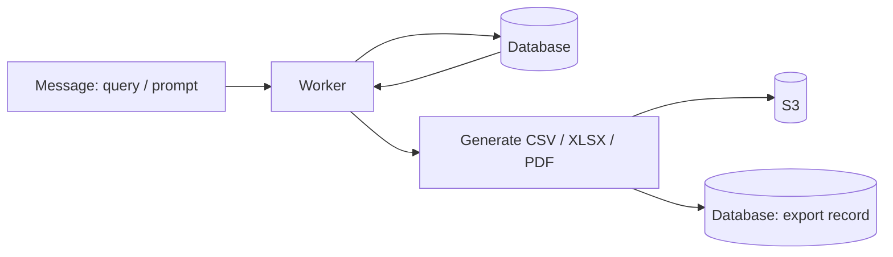

# export-document-worker

Worker microservice that exports documents (CSV, XLSX, PDF) from a message containing a query string or prompt.

## How it works

1. Receives a message with a query string (or prompt) describing the export.
2. Queries the database to retrieve the relevant data.
3. Generates the document in the format the user asked for (CSV, XLSX or PDF). Any other format stops the process.
4. Uploads the file to S3 and saves the export record in the database.

## Supported formats

- CSV
- XLSX
- PDF

## Configuration

Configuration is provided through environment variables. Never commit secrets.

## Development

See [AGENTS.md](AGENTS.md) for contribution guidelines. Additional documentation lives in [docs/](docs/).
