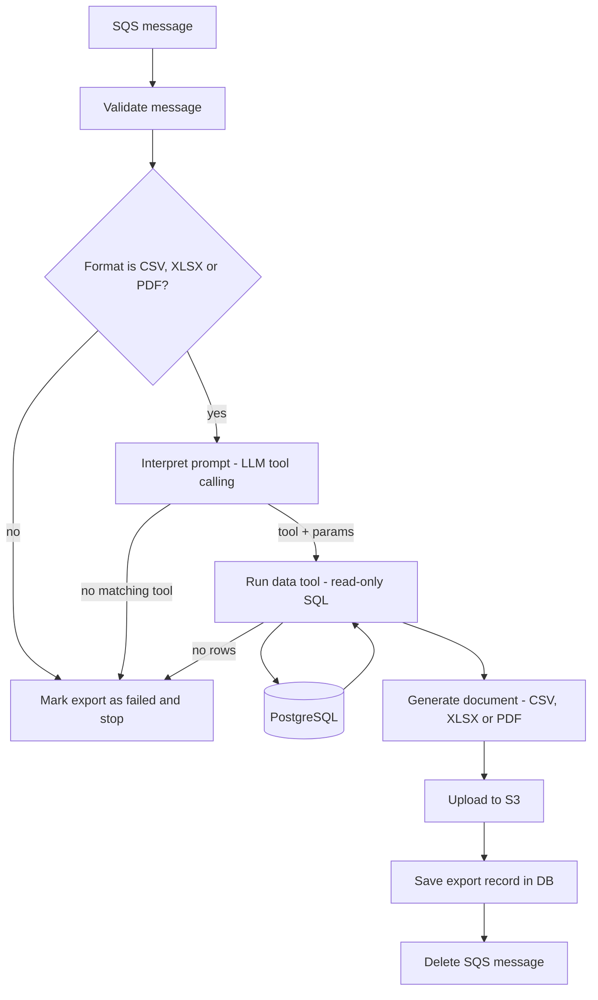

# Architecture

## Overview

`export-document-worker` consumes messages from SQS. Each message contains an administrator's free-text request (for example "how many bids and accesses did auction 123 get last week, as PDF") plus structured context. The worker translates the request into a call to a predefined data tool, retrieves the data from PostgreSQL, generates the requested file (CSV, XLSX or PDF), uploads it to S3 and records the result in the database.

## Flow

## Components

| Component | Responsibility |
| --- | --- |
| Consumer | Polls SQS, validates the message, acks on success. |
| Interpreter | Sends the prompt and the tool catalog to the LLM; returns a tool name and parameters validated with Zod. |
| Data tools | Predefined, parameterized, read-only queries (auction stats, bid counts, access counts, ...). |
| Generators | Turn tool results into CSV, XLSX or PDF. |
| Storage | Uploads the file to S3. |
| Repository | Writes the export record (status, S3 key, params, errors) to PostgreSQL. |

## Key decisions

- **No RAG.** The data is structured and the questions are aggregates; SQL is exact. RAG targets unstructured text.
- **No MCP for now.** The worker controls its own LLM calls, so plain tool calling is enough. The data tools can be wrapped in an MCP server later if other agents need them.
- **The LLM never writes SQL.** It only selects a tool and its parameters. Every query is written by us and parameterized, which prevents SQL injection and keeps results deterministic and testable.
- **Read-only database access.** The worker connects with a read-only user for data tools. Writes are limited to the export record.
- **The frontend sends a polished prompt.** The frontend does basic validation and cleanup (for example empty or oversized input) before the message is queued, so the worker does not repeat that work.
- **Only CSV, XLSX and PDF are supported.** The message carries the format the user chose. Any other format interrupts the process before the LLM and the database are called; the export is marked as failed with a reason and the message is not retried.
- **The format comes from the message, not the LLM.** The LLM only chooses the tool and its parameters.

## Data tools

Each tool has a name, a description (shown to the LLM), a Zod parameter schema and a SQL query. Implemented:

- `getAuctionStats` - title, total visits, total bids, unique bidders and highest bid for one auction code. Visits is a lifetime counter; there is no per-access log, so access counts by date range are not available.

Add a new tool by following [development.md](development.md).

## Security

- Messages come from the platform's own backend, which is responsible for authenticating the administrator. The worker treats the message as untrusted input and validates its schema.
- The prompt is untrusted even after frontend validation, which can be bypassed. Because the LLM can only select predefined tools, prompt injection cannot reach the database beyond those tools.
- Set a query timeout (30 seconds). A row limit will be added when a tool returns lists.
- Secrets (database, AWS, LLM key) come from environment variables.

## Open decisions

- Delivery of the result to the requester (presigned URL, notification, webhook). For now the worker only saves to S3 and the database.

## Error handling

- Unsupported format, no matching tool and no rows mark the export `FAILED` with a specific reason.
- Any other error is logged, marks the export `FAILED` with a generic reason, and the message is acknowledged. The user can request the export again.
- Messages that cannot be parsed are not acknowledged, so SQS retries them and moves them to the DLQ (configure `maxReceiveCount` on the queue).
